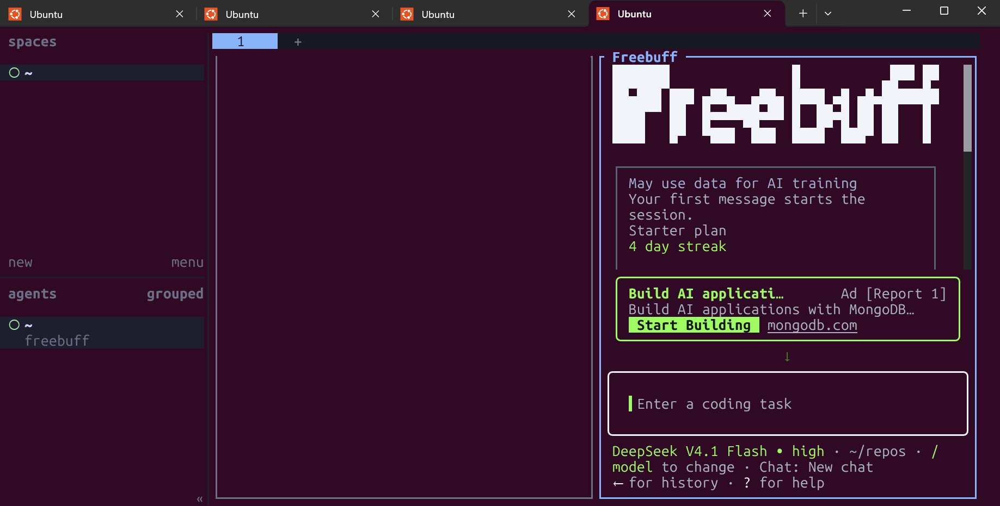

# herdr-freebuff

[](https://github.com/jond34/herdr-freebuff/actions/workflows/ci.yml)
[](https://github.com/jond34/herdr-freebuff/releases)
[](LICENSE)

Run [Freebuff](https://freebuff.com) in a [Herdr](https://herdr.dev) plugin
pane and let Herdr see it: live `idle` / `working` / `blocked` state in the
sidebar, native notifications, `herdr agent wait`, and conversation restore
after a Herdr restart.

## Screenshots

| Started by hand in a pane | Opened by the plugin | Pane beside it closed |
|---|---|---|
|  |  |  |
| Herdr reads the foreground command as `freebuff`, has no built-in kind by that name, and lists nothing. | The plugin reports the pane over the socket API, so the sidebar lists it and carries its state. | Closing the pane beside it leaves the `freebuff` entry in place; only the Freebuff pane itself owns that entry. |

## Install

```sh
herdr plugin install jond34/herdr-freebuff
```

That tracks `main`. To pin the current release instead:

```sh
herdr plugin install jond34/herdr-freebuff --ref v0.2.1
```

A pinned install stays on its ref; a default install picks up new commits on
`main` when you run `herdr plugin update`. There is no setup step, PATH change,
or launcher replacement.

Bind `prefix+f` in `~/.config/herdr/config.toml`:

```toml
[[keys.command]]
key = "prefix+f"
type = "plugin_action"
command = "freebuff.integration.new-task"
description = "Freebuff: new task"
```

On Windows the id is `freebuff.integration.new-task-windows`. Herdr 0.9.5
rejects a manifest that repeats an id, even when the entries claim different
platforms, so every Windows entrypoint carries a `-windows` suffix
(`task-windows`, `resume-last-windows`, `doctor-windows`, `register-pane-windows`).

Run `herdr server reload-config`, then restart the Herdr client (detach with
`prefix+q` and run `herdr` again) so it picks up the new keymap, and press
`prefix+f`. Herdr keybindings can only invoke plugin actions, so the plugin
ships a `new-task` action that opens the pane. To skip the key, open it from
the CLI:

```sh
herdr plugin pane open --plugin freebuff.integration --entrypoint task
```

Ask for `--entrypoint task-windows` on Windows; asking for `task` there fails
with `platform_unsupported` rather than running a shell script that host does
not have.

The pane opens in the directory of the pane you invoke it from, so Freebuff
starts in that project. Pass `--cwd <dir>` to the CLI form to start somewhere
else.

If `prefix+f` does nothing at all, check that the prefix itself reaches Herdr:
press `prefix+?`. Editors and terminals that bind `ctrl+b` (VS Code toggles its
sidebar with it) swallow the prefix before Herdr sees it. Accept a second,
unclaimed prefix and keep both:

```toml
[keys]
prefix = ["ctrl+b", "ctrl+space"]

[[keys.command]]
key = "prefix+f"
type = "plugin_action"
command = "freebuff.integration.new-task"
description = "Freebuff: new task"
```

The `[keys]` table has to come before any `[[keys.command]]` entry.

### Requirements

| Requirement | Notes |
|---|---|
| Herdr 0.9.5 | the `herdr` TUI only, not `herdr-app`/`herdr-core`; validated only on 0.9.5, and `min_herdr_version` refuses anything older. The app's agent list holds only programs that emit [OSC 7501](https://herdr.dev/core), which Freebuff does not |
| Freebuff 0.2.36 | validated; other 0.2.x releases are best-effort |
| Linux, WSL2, macOS, or Windows 10+ | On WSL2, Herdr and Freebuff must run in the same distro. macOS passes the test suite in CI, including the process inspection the watcher does without procfs, but has not been walked by hand against a real Freebuff pane. Windows 11 was walked by hand; [Windows](#windows) lists the two limits that matter before installing |
| Node.js 22+ | runs the background watcher. Without it a pane still starts Freebuff, but the pane stays `unknown` and `doctor` exits |

## What works

| Surface | Behavior |
|---|---|
| State | `idle`, `working`, and `blocked` reported per pane, derived from Freebuff's own chat checkpoint and log rather than screen scraping |
| Notifications | Herdr's native agent notifications; the plugin adds no second notification path |
| `herdr agent wait` | waits on the reported state like any other agent |
| Session restore | reports the chat ID, chat path, and a resume command, and Herdr runs it after a restart, so the pane reopens on the same conversation |
| `doctor` | pane action that prints the watcher, launcher, and child PIDs, the bound chat, and the resume argv |
| `register-pane` | pane action that lists a pane you started yourself as a Freebuff agent (see [Panes you start yourself](#panes-you-start-yourself)) |
| Panes | `task` and `resume-last` entrypoints, plus the `new-task` action behind `prefix+f` (see [Install](#install)) |

Each pane binds its own Freebuff chat by process tree, so two panes in the same
project stay independent. Windows has no process tree cheap enough to poll, so
there the pane binds the chat log written after it launched and keeps that
binding until its writer exits: a recycled process ID cannot produce a log
written after the pane started. `doctor` reports what the host can see
(`seesOpenFiles`, `seesProcessTable`) and which source named the pane's chat.

Tested in the suite: state transitions, two-pane isolation, the resume
arguments, and `doctor`. Walked by hand on Herdr 0.9.5: stopping and restarting
the server reopened the pane on the previous conversation — Herdr ran the
reported `freebuff --continue <chat>`, and the earlier prompt and reply were both
there. Freebuff opens a fresh chat directory for the resumed session, so the
bound chat ID changes even though the conversation continues. Not observed: a
notification firing; that is Herdr's own response to a reported state, which
this plugin does not duplicate.

## Panes you start yourself

Herdr knows about a Freebuff pane because something reports it. The plugin's
watcher does that for panes it opened. A `freebuff` you type into a plain pane
reports nothing, so Herdr lists it as `unknown` and the sidebar stays empty.

Register that pane once Freebuff is running in it, and it appears as an agent:

```sh
herdr pane report-agent w1:p2 --source freebuff --agent freebuff --state unknown
```

Inside Herdr, the `Freebuff: register this pane` action does the same for the
focused pane. It registers the pane with state `unknown` and claims nothing
else: nothing watches that session, so its entry does not follow
`working` / `blocked` and stays until the pane closes. Starting Freebuff as a
plugin pane gets you the live state instead.

Two details matter. Register while Freebuff is in the foreground: Herdr drops a
self-reported agent from a pane that has returned to its shell. And every report
must carry a `--seq` greater than the one Herdr last accepted for that source;
the script handles this with a microsecond timestamp, so do not hand-write a
smaller number.

### Why this is manual

Herdr identifies an agent from the pane's foreground command text, then looks
that name up in a closed list of built-in agent kinds (`Agent` in
`src/detect/mod.rs`). Detection manifests carry state rules for a kind in that
list, and a local override under `~/.config/herdr/agent-detection/` can only
shadow a kind that already exists. Freebuff is not one of them, so on Herdr
0.9.5 there is nothing a manifest, an override, or this plugin can add that
makes Herdr recognise `freebuff` on its own.

What would change that, in order of value:

1. **Herdr adds Freebuff as a built-in agent kind** — an enum variant plus a
   bundled manifest. The manifest needs either screen rules (fragile, and it
   duplicates what this plugin already knows from Freebuff's own logs) or a
   detection-only entry that recognises the pane without claiming a state.
2. **Freebuff reports its own lifecycle** — hooks that send idle / working /
   blocked and the chat ID to Herdr's socket, the way OpenCode, Kimi, and Droid
   integrations do. That gives real state, not scraped state, and needs both
   Freebuff and Herdr to ship a side of it.

Until one of those lands, the honest maximum is what this section describes: a
pane Herdr lists, with state left `unknown`.

## Limits

This is a **self-reported agent**, not a built-in Herdr agent kind. Herdr 0.9.5
gives self-reported agents a smaller command surface than built-in kinds:

| Command | Freebuff support | Workaround |
|---|---|---|
| `herdr agent prompt` | Unavailable | Type into the Freebuff pane directly |
| `herdr agent send-keys` | Unavailable | Send keys to the pane directly |
| `herdr agent start --kind` | Unavailable | Use the `task` or `resume-last` pane |
| `herdr agent explain` | Unavailable | Use the `doctor` action for process and chat evidence |

`herdr pane send-text` can write into the pane, but it lacks the native
foreground-agent guard and is not equivalent to `agent prompt`; this plugin
does not wrap it, seed a detection override, or use a fake agent label.

The rest of the surface above does work: state reporting, notifications,
`herdr agent wait`, session restore, and `doctor`. Native parity needs a Herdr
change; see [herdrdev/herdr discussion #4832](https://github.com/herdrdev/herdr/discussions/4832).

### Windows

Entrypoints are PowerShell twins of the shell scripts, run with `-NoProfile
-ExecutionPolicy Bypass`; the watcher is the same Node file on every host.
Their ids carry a `-windows` suffix because Herdr 0.9.5 refuses a repeated id.
Status, notifications, session restore, and `doctor` behave as described above.

Two limits are worth knowing before installing:

- A Group Policy that sets execution policy for the machine or user overrides
  the `-ExecutionPolicy Bypass` the manifest passes, and the pane closes as soon
  as it opens. `doctor` prints the policy for every scope, so that is the first
  thing to read. Locked-down machines are not supported.
- Status reporting needs Node on `PATH`. The npm install of Freebuff brings it;
  a tarball install may not, and then the pane still runs but stays `unknown`.

The mechanisms were verified by hand on Windows 11 against Herdr 0.9.5 and
Freebuff 0.2.36: pane environment, chat log shape, process liveness, TUI input,
and a reported `working` state. That walk predates the watcher split, so a live
pane on the current code is unverified; CI covers parsing and the binding rules
rather than a live pane.

## Trust

The plugin is a shell entrypoint plus one Node watcher, both in this repository:

- No binary, installer, npm package, or release asset.
- No global `PATH` wrapper and no modification of `~/.local/bin/freebuff`.
- No network calls, telemetry, or hosted service. It reads Freebuff's local
  chat directory and reports to Herdr over the existing Herdr socket.
- No prompt or message content is sent to Herdr; the only blocked-state message
  is generic.

## Troubleshooting

`doctor` runs inside Herdr against the focused pane. From a shell, pass a
launcher PID and optional chat ID to inspect an unresolved pane:

```sh
sh scripts/doctor.sh [launcher-pid] [chat-id]
```

It reports the watcher, launcher, and descendant PIDs, the bound chat directory,
and the resume argv. On Windows it also reports `process-table-unavailable` for
the session match, because there is no cheap process table to search there; pass
the launcher PID explicitly instead. It matches watchers by pane ID and inherited
`HERDR_SOCKET_PATH`, so two Herdr sessions that both use `w1:p2` do not collide;
when identity cannot choose a candidate it reports the ambiguity instead of
guessing.

If a pane is not bound to a chat, confirm that Freebuff is actually running in
that pane and that the chat directory exists under
`~/.config/manicode/projects/<project>/chats/`. `resume-named` refuses to start
when the named chat is missing rather than silently opening a different one.

## Development

Link the working tree instead of installing:

```sh
herdr plugin link /path/to/herdr-freebuff
herdr plugin list
herdr plugin action list --plugin freebuff.integration
```

The tests drive `launch.sh` with a fake launcher/child process tree and a
JSON-recording Herdr stub, so they exercise the real PID binding path
without a Herdr install:

```sh
sh tests/run.sh
node --check scripts/status-watcher.js
```

`scripts/status-watcher.js` reads the environment and wires four modules, each
of which owns one decision: `watcher/binding.js` which chat this pane owns and
where chats live, `watcher/turns.js` what state the pane is in, `watcher/herdr.js`
the pane reports and resume argv, `watcher/doctor.js` the diagnostic report. A
change to one of those starts there and does not need the others.

`tests/platform.test.js` exercises the platform seam and the chat-binding rules
without a pane, and `tests/manifest.test.js` asserts that every entrypoint has
both twins and both scripts exist. CI runs the suite on Linux and macOS, and on
`windows-latest`, where it parses every `.ps1` file and runs the platform and
manifest suites.

See [CONTRIBUTING.md](CONTRIBUTING.md) for the fixture and data rules, and
[CHANGELOG.md](CHANGELOG.md) for release history.

## Lineage

This project began from
[TheMetalStorm/herdr-freebuff-plugin](https://github.com/TheMetalStorm/herdr-freebuff-plugin).
It is a standalone repository, not a GitHub fork, because the Herdr marketplace
excludes forks; the original commits and attribution are preserved.

The original plugin supplied the architecture, pane launch, and screen-marker
ideas. [1024ch/herdr-freebuff-plugin](https://github.com/1024ch/herdr-freebuff-plugin)
supplied the Node watcher, PID-bound chat binding, incremental log tail, and
checkpoint arbitration. Both are MIT licensed; see [CREDITS.md](CREDITS.md) and
[LICENSE](LICENSE).

## License

MIT. See [LICENSE](LICENSE).
