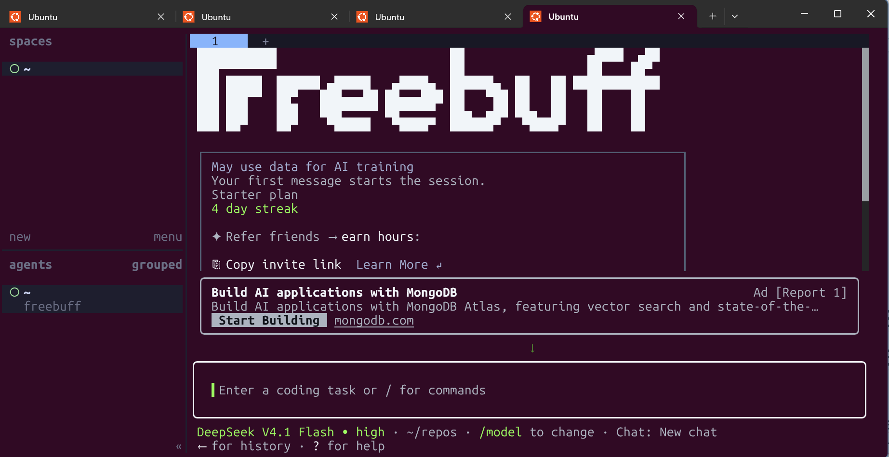

# herdr-freebuff

[](https://github.com/jond34/herdr-freebuff/actions/workflows/ci.yml)
[](https://github.com/jond34/herdr-freebuff/releases)
[](LICENSE)

Run [Freebuff](https://freebuff.com) in a [Herdr](https://herdr.dev) pane and let
Herdr see it: `idle` / `working` / `blocked` in the sidebar, native
notifications, `herdr agent wait`, and the same conversation back after a Herdr
restart.

```sh
herdr plugin install jond34/herdr-freebuff
```

That tracks `main`. Pin a release with `--ref v0.2.1`; a pinned install stays on
its ref, and `herdr plugin update` moves an unpinned one. There is no setup step,
`PATH` change, or launcher replacement.

| Started by hand in a pane | Opened by the plugin | Pane beside it closed |
|---|---|---|
|  |  |  |
| Herdr reads the foreground command as `freebuff`, has no kind by that name, and lists nothing. | The plugin reports the pane, so the sidebar lists it and carries its state. | Closing the other pane leaves the `freebuff` entry in place. |

## Install

The pane needs a key, since Herdr keybindings can only invoke plugin actions.
Add this to `~/.config/herdr/config.toml`:

```toml
[[keys.command]]
key = "prefix+f"
type = "plugin_action"
command = "freebuff.integration.new-task"
description = "Freebuff: new task"
```

Run `herdr server reload-config`, restart the client (`prefix+q`, then `herdr`),
and press `prefix+f`. Without a key:

```sh
herdr plugin pane open --plugin freebuff.integration --entrypoint task
```

The pane opens in the directory you invoke it from; add `--cwd <dir>` to start
elsewhere. On Windows ask for `task-windows`. Every Windows entrypoint carries a
`-windows` suffix because Herdr 0.9.5 rejects a manifest that repeats an id, and
asking for `task` there fails with `platform_unsupported` instead of running a
shell script the host does not have.

If `prefix+f` does nothing, first check that Herdr receives the prefix at all by
pressing `prefix+?`. Editors that bind `ctrl+b` (VS Code opens its sidebar with
it) swallow the prefix before Herdr sees it. Add a second prefix and keep both:

```toml
[keys]
prefix = ["ctrl+b", "ctrl+space"]
```

The `[keys]` table has to come before any `[[keys.command]]` entry.

### Requirements

| Requirement | Notes |
|---|---|
| Herdr 0.9.5 | the `herdr` TUI, not `herdr-app`/`herdr-core`. `min_herdr_version` refuses older releases. The app's agent list holds only programs that emit [OSC 7501](https://herdr.dev/core), which Freebuff does not |
| Freebuff 0.2.36 | validated; other 0.2.x releases are best-effort |
| Linux, WSL2, macOS, or Windows 10+ | On WSL2, Herdr and Freebuff must run in the same distro. macOS passes CI but has not been walked by hand against a real pane. Windows 11 was walked by hand; see [Windows](#windows) for its two limits |
| Node.js 22+ | runs the background watcher. Without it the pane starts but stays `unknown`, and `doctor` exits |

## What you get

| Surface | Behavior |
|---|---|
| State | `idle`, `working`, and `blocked` per pane, read from Freebuff's chat checkpoint and log rather than the screen |
| Notifications | Herdr's native agent notifications, with no second notification path |
| `herdr agent wait` | waits on the reported state like any other agent |
| Session restore | reports the chat ID, path, and resume command, which Herdr runs after a restart |
| `doctor` | pane action that prints watcher, launcher, and child PIDs, the bound chat, and the resume argv |
| `register-pane` | pane action that lists a pane you started yourself (see [below](#panes-you-start-yourself)) |
| Panes | `task` and `resume-last` entrypoints, plus the `new-task` action behind `prefix+f` |

Each pane binds its own chat by process tree, so two panes in the same project
stay independent. Windows has no process table cheap enough to poll, so a pane
there binds the log written after it launched and keeps that binding until the
writer exits. `doctor` reports which evidence named the chat.

Tested in the suite: state transitions, two-pane isolation, resume arguments, and
`doctor`. Walked by hand on Herdr 0.9.5: restarting the server reopened the pane
on the previous conversation, with the earlier prompt and reply both there.
Freebuff opens a fresh chat directory for a resumed session, so the bound chat ID
changes while the conversation continues. A notification firing was not
observed; that is Herdr's own response to a reported state.

## Panes you start yourself

Freebuff typed into a plain pane reports nothing, so Herdr lists it as `unknown`
and the sidebar stays empty. Register it once Freebuff is running:

```sh
herdr pane report-agent w1:p2 --source freebuff --agent freebuff --state unknown
```

The `Freebuff: register this pane` action does the same for the focused pane.
That entry does not follow `working` or `blocked` and goes away when the pane
closes; a plugin pane is what gets live state. Register while Freebuff is in the
foreground, because Herdr drops a self-report from a pane that has returned to
its shell, and let the script's `--seq` stand rather than writing a smaller one.

Herdr identifies an agent from the pane's foreground command and a closed list of
built-in kinds, and Freebuff is not one of them. Nothing a manifest, an override,
or this plugin adds makes Herdr recognise `freebuff` on its own: that needs a
built-in kind in Herdr or lifecycle hooks in Freebuff. [herdrdev/herdr discussion
#4832](https://github.com/herdrdev/herdr/discussions/4832) tracks native parity.

## Limits

Self-reported agents get a smaller command surface than built-in kinds in Herdr
0.9.5:

| Command | Freebuff support | Workaround |
|---|---|---|
| `herdr agent prompt` | Unavailable | Type into the pane |
| `herdr agent send-keys` | Unavailable | Send keys to the pane |
| `herdr agent start --kind` | Unavailable | Use the `task` or `resume-last` pane |
| `herdr agent explain` | Unavailable | Use `doctor` |

`herdr pane send-text` can write into the pane, but it lacks the native
foreground-agent guard, so this plugin does not wrap it. State, notifications,
`agent wait`, restore, and `doctor` all work.

## Windows

Entrypoints are PowerShell twins of the shell scripts, run with `-NoProfile
-ExecutionPolicy Bypass`, and the watcher is the same Node file on every host.
Two limits are worth knowing:

- A Group Policy that sets execution policy for the machine or user overrides the
  flag the manifest passes, and the pane closes as soon as it opens. `doctor`
  prints the policy for every scope.
- Status reporting needs Node on `PATH`. The npm install of Freebuff brings it; a
  tarball install may not, and the pane then stays `unknown`.

The mechanisms were verified by hand on Windows 11 against Herdr 0.9.5 and
Freebuff 0.2.36: pane environment, chat log shape, process liveness, TUI input,
and a reported `working`. That walk predates the watcher split, so a live pane on
the current code is unverified; CI covers parsing and the binding rules rather
than a live pane.

## Troubleshooting

`doctor` runs against the focused pane inside Herdr. From a shell:

```sh
sh scripts/doctor.sh [launcher-pid] [chat-id]
```

It prints the watcher, launcher, and descendant PIDs, the bound chat directory,
and the resume argv. It matches watchers by pane ID and inherited
`HERDR_SOCKET_PATH`, so two sessions that both use `w1:p2` do not collide, and it
reports ambiguity rather than guessing. On Windows it reports
`process-table-unavailable` for the session match, so pass the launcher PID.

If a pane has no chat, confirm Freebuff is running in it and that the chat exists
under `~/.config/manicode/projects/<project>/chats/`. `resume-named` refuses a
missing chat instead of opening a different one.

## Development

```sh
herdr plugin link /path/to/herdr-freebuff
sh tests/run.sh
```

The tests drive `launch.sh` with a fake launcher and a JSON-recording Herdr stub,
so the real PID binding path runs without Herdr installed.
`scripts/status-watcher.js` wires four modules, each owning one decision:
`binding.js` which chat a pane owns, `turns.js` what state it is in, `herdr.js`
the reports and resume argv, `doctor.js` the diagnostic report. CI runs the suite
on Linux and macOS, and on `windows-latest` where it parses every `.ps1` file and
runs the platform and manifest suites.

See [CONTRIBUTING.md](CONTRIBUTING.md) for fixture and data rules,
[CHANGELOG.md](CHANGELOG.md) for release history, and [SECURITY.md](SECURITY.md)
for scope.

## Trust

The plugin is a shell entrypoint plus one Node watcher, both in this repository.
No binary, installer, npm package, or release asset. No global `PATH` wrapper and
no change to `~/.local/bin/freebuff`. No network calls, telemetry, or hosted
service: it reads Freebuff's local chat directory and reports over the Herdr
socket. No prompt or message content reaches Herdr, and the only blocked-state
message is generic.

## License

MIT. Started from
[TheMetalStorm/herdr-freebuff-plugin](https://github.com/TheMetalStorm/herdr-freebuff-plugin),
with the Node watcher and chat binding from
[1024ch/herdr-freebuff-plugin](https://github.com/1024ch/herdr-freebuff-plugin).
Both are MIT licensed; see [CREDITS.md](CREDITS.md) and [LICENSE](LICENSE).
